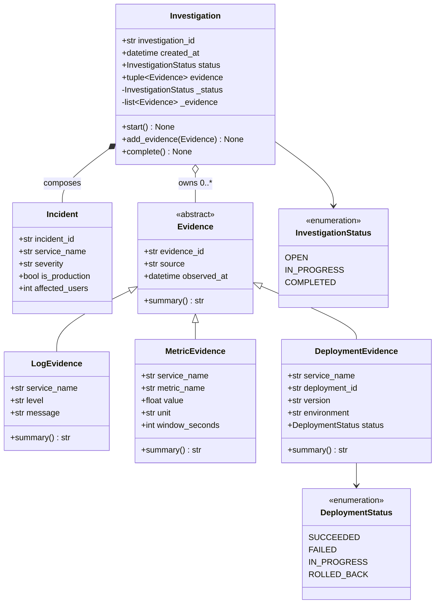

# OpsPilot — Domain Models

**Status:** Day 8 implementation. This document describes the in-memory
investigation domain model only. Persistence, HTTP APIs, retrieval, agents and
real diagnostic integrations are not implemented yet.

## 1. Purpose

The domain model is the stable centre of OpsPilot. It answers three questions:

1. What facts do we know about an incident? (`Incident`)
2. What is being investigated, and how far has that work progressed?
   (`Investigation`)
3. What evidence supports the investigation? (`Evidence` and its subclasses)

The model contains business rules, not framework code. It has no database
dependency, no FastAPI dependency, and no monitoring-client dependency, so the
rules can be tested in milliseconds and reused by a future API, worker or
workflow.

## 2. Incident vs Investigation

An `Incident` is an immutable statement of impact: which service, how severe,
whether it is production, and how many users are affected.

An `Investigation` is the mutable work performed in response to that incident.
It has its own identifier, creation time, lifecycle status and evidence.

```text
Investigation HAS-A Incident   (composition)
Investigation IS-NOT-A Incident (no inheritance)
```

Keeping them separate prevents a common modelling mistake: adding investigation
fields to the incident record until the incident becomes a god object. An
incident can exist before an investigation starts, and one incident may later
need more than one investigation.

## 3. Evidence abstraction

`Evidence` is an abstract base class (`abc.ABC`) and a frozen dataclass. It
defines the contract every evidence type must satisfy:

| Member | Meaning |
|---|---|
| `evidence_id` | Unique identifier within one investigation |
| `source` | Where the evidence came from, e.g. `incident-log.jsonl` |
| `observed_at` | Timezone-aware time at which the fact was observed |
| `summary` | Abstract property returning a short human-readable description |

`Evidence` cannot be instantiated directly. Subclasses must implement
`summary`. Common validation runs in `Evidence.__post_init__`:

- `evidence_id` and `source` must be non-empty strings.
- `observed_at` must be a `datetime` with a timezone.

The abstraction is deliberately small. It defines what all evidence has in
common and nothing else.

## 4. Concrete evidence types

### `LogEvidence`

Represents one application log line. Fields: `service_name`, `level`,
`message`. The level is validated against the Day 6 `LOG_LEVELS` constant and
normalised to upper case, so the log rules are not duplicated. The
`from_log_record()` class method converts an existing `LogRecord` into
evidence.

### `MetricEvidence`

Represents a numeric measurement. Fields: `service_name`, `metric_name`,
`value`, `unit`, `window_seconds`. The value must be a finite number — `NaN`,
positive infinity and negative infinity are rejected because they cannot be
compared or aggregated meaningfully. The window must be a positive integer.

### `DeploymentEvidence`

Represents a deployment associated with the incident. Fields: `service_name`,
`deployment_id`, `version`, `environment`, `status`. The status is a
`DeploymentStatus` enum (`SUCCEEDED`, `FAILED`, `IN_PROGRESS`, `ROLLED_BACK`),
so an invalid state cannot be stored as a free-form string.

All three classes are frozen dataclasses with `slots=True`.

## 5. Inheritance and polymorphism

```text
Evidence (abstract)
├── LogEvidence
├── MetricEvidence
└── DeploymentEvidence
```

Inheritance is used only where the subtype genuinely *is* the abstraction:
every concrete class is a piece of evidence and must provide `summary`.

Callers depend on the abstraction:

```python
for item in investigation.evidence:
    print(item.summary)  # no isinstance() branching
```

Adding a new evidence type does not require changing `Investigation`. That is
the Open/Closed Principle in practice.

## 6. Composition

`Investigation` composes:

- one existing `Incident` (stored by reference, never mutated), and
- zero or more `Evidence` objects, owned by the investigation.

Composition is preferred over inheritance because an investigation is not a
special kind of incident. It *has* an incident and *owns* evidence. This keeps
both concepts independently testable and lets the incident remain immutable.

## 7. Encapsulation of evidence

The aggregate stores evidence in a private field, `_evidence`. Callers cannot
reach the mutable list:

```python
investigation.evidence  # returns tuple[Evidence, ...] — a snapshot
```

The property returns a tuple, so:

- callers cannot append to the internal list through the public API;
- a snapshot taken earlier does not change when new evidence is added;
- duplicate-ID and lifecycle checks cannot be bypassed by direct list access.

Python privacy is a convention, not a security boundary; `_evidence` is still
reachable by name. The design makes the correct path the obvious one and keeps
all mutation behind `add_evidence()`.

## 8. Investigation lifecycle

```text
OPEN ──start()──> IN_PROGRESS ──complete()──> COMPLETED
```

Rules enforced by the aggregate:

- A new investigation starts as `OPEN`.
- `start()` is valid only from `OPEN`.
- `complete()` is valid only from `IN_PROGRESS`.
- Evidence may be added only while `IN_PROGRESS`.
- Duplicate `evidence_id` values are rejected.
- Invalid transitions raise `ValueError` and leave the state unchanged.
- `status` is a read-only property; callers cannot assign it.

No remediation or approval logic exists at this stage. Those are later roadmap
concerns and must not be inferred from this model.

## 9. Why `Evidence` is immutable

Evidence is a recorded fact. If a log line said `ERROR` at 10:30, editing that
object to say `INFO` would silently rewrite history and undermine every
conclusion built on it. A frozen dataclass makes accidental mutation fail
immediately, makes evidence safe to share between functions, and makes equality
and debugging predictable.

## 10. Why `Investigation` is mutable

An investigation is a process, not a fact. It moves through states and
accumulates evidence over time. Replacing the whole aggregate on every change
would be awkward for callers and would obscure the lifecycle. Mutability is
therefore contained inside the aggregate and exposed only through controlled
methods.

## 11. Domain model, not database model

These classes contain no table names, columns, ORM base classes, sessions or
serialization rules. They express business invariants:

- severity must be a supported value;
- timestamps must be timezone-aware;
- metric values must be finite;
- evidence IDs must be unique within an investigation;
- lifecycle transitions must be legal.

A future persistence layer will map these objects to PostgreSQL rows. The
mapping belongs outside the domain, so the rules stay independent of the
storage technology.

## 12. How future layers will use these objects

- **API layer (later):** converts request bodies into domain objects and
  domain objects into response schemas. Pydantic boundary validation arrives on
  Day 9 and later.
- **Retrieval layer (later):** produces evidence from runbooks and past
  incidents, then adds it through `add_evidence()`.
- **Diagnostic tools (later):** return read-only log, metric and deployment
  observations that become concrete evidence objects.
- **Workflow layer (later):** drives `start()` and `complete()` and reads the
  evidence snapshot when generating hypotheses.
- **Persistence layer (later):** stores the incident and investigation, and
  reloads them without changing the domain rules.

## Class diagram



## Explicit non-goals for Day 8

- No FastAPI routes or Pydantic schemas.
- No SQLAlchemy, ORM mapping or database migrations.
- No PostgreSQL, pgvector, Redis or background jobs.
- No LangGraph workflow, LLM calls, RAG or agents.
- No real monitoring integrations.
- No remediation execution or approval gate.
