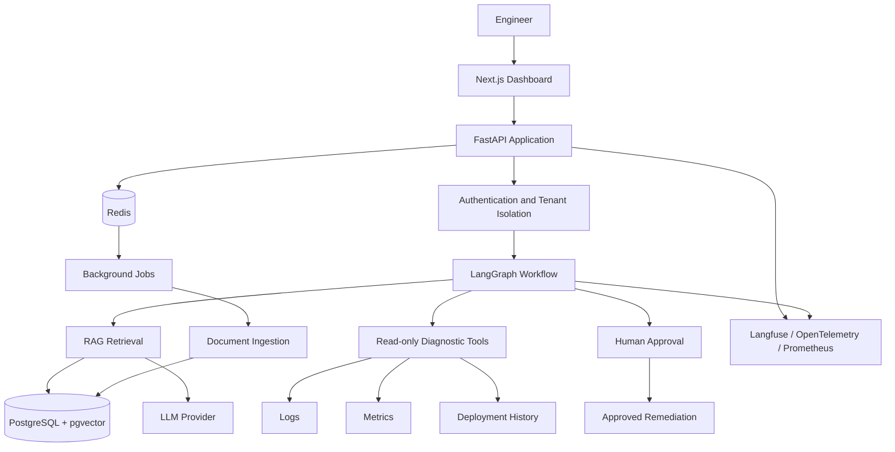

# OpsPilot — Architecture Overview

## 1. Purpose

OpsPilot is an AI-assisted incident investigation platform.

It helps engineers investigate production incidents by combining internal engineering knowledge, diagnostic tools, retrieval, and evidence-backed AI reasoning.

## 2. Architectural Style

Target architecture:

- Modular monolith initially.
- Clear domain and application boundaries.
- API-driven frontend/backend separation.
- Asynchronous ingestion pipeline.
- Stateful AI investigation workflows.
- Explicit human approval for risky actions.

Microservices will not be introduced without a measurable architectural need.

## 3. High-Level Architecture

## 4. Major Components

### API Application

Responsibilities:

- HTTP endpoints
- Request validation
- Authentication integration
- Tenant context
- Application service invocation
- Response serialization

Technology: FastAPI and Pydantic.

### Core Domain

Responsibilities:

- Incident models
- Investigation entities
- Evidence representations
- Approval state
- Domain rules
- Interfaces for external dependencies

### Ingestion

Responsibilities:

- Document loading
- Parsing and cleaning
- Metadata extraction
- Chunking
- Embedding generation
- Vector indexing

### Retrieval

Responsibilities:

- Query processing
- Similarity search
- Metadata filtering
- Hybrid retrieval
- Reranking
- Citation construction

### Agents and Workflows

Responsibilities:

- Investigation state
- Workflow orchestration
- Diagnostic tool invocation
- Conditional routing
- Retry and recovery
- Human approval

### Evaluation

Responsibilities:

- Evaluation datasets
- Retrieval metrics
- Answer quality
- Tool success
- Regression evaluation

### Observability

Responsibilities:

- Tracing
- Metrics
- Token usage
- Latency
- Cost
- Error tracking

## 5. Three Separate Pipelines

### AI Ingestion and Evaluation Pipeline

Documents
-> Parsing
-> Cleaning
-> Chunking
-> Embeddings
-> Vector indexing
-> Retrieval evaluation
-> Generation evaluation

### Runtime Request Pipeline

Request
-> Authentication
-> Tenant isolation
-> Investigation workflow
-> Retrieval and diagnostics
-> Evidence analysis
-> Grounded response
-> Tracing and metrics

### CI/CD Deployment Pipeline

Pull request
-> Lint
-> Type checking
-> Unit tests
-> Integration tests
-> AI evaluation regression
-> Container build
-> Security checks
-> Staging
-> Approval
-> Production deployment

## 6. Safety Requirements

- Diagnostic tools are read-only by default.
- Tool permissions must be explicit.
- Tenant boundaries must be enforced.
- Retrieved documents are untrusted input.
- Prompt injection must be considered.
- Sensitive information must be protected.
- Risky remediation requires human approval.
- Approval must be auditable.

## 7. Technology Stack

| Layer           | Technology                    |
| --------------- | ----------------------------- |
| Frontend        | Next.js, React, TypeScript    |
| API             | FastAPI, Pydantic             |
| Workflow        | LangGraph                     |
| Database        | PostgreSQL, pgvector          |
| LLM             | LLM provider                  |
| Embeddings      | Embedding model/provider      |
| Cache           | Redis                         |
| Background Jobs | Celery or equivalent          |
| Evaluation      | pytest, custom harness, RAGAS |
| Tracing         | Langfuse, OpenTelemetry       |
| Metrics         | Prometheus                    |
| Infrastructure  | Docker, Compose               |
| CI/CD           | GitHub Actions                |
| Deployment      | One cloud provider            |

## 8. Architecture Evolution

Implement the simplest working version first.

Introduce abstractions and frameworks only when they solve a real problem.

Record significant architecture decisions under `docs/adr/`.
